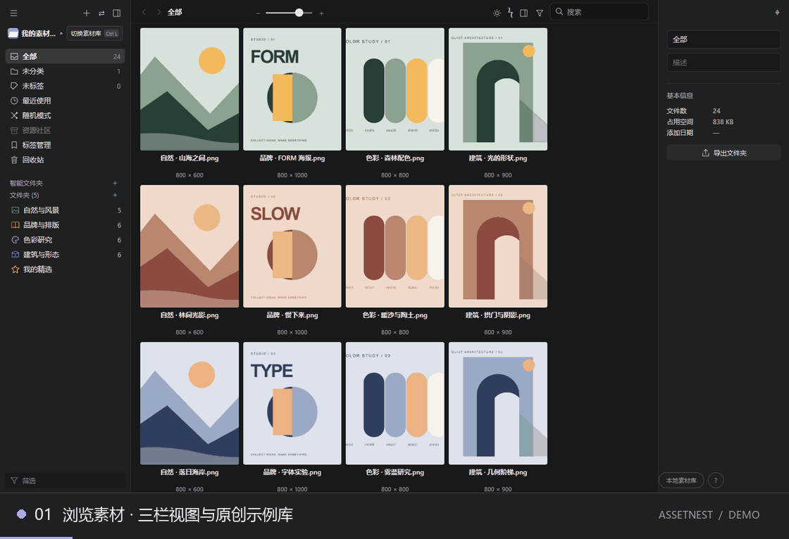
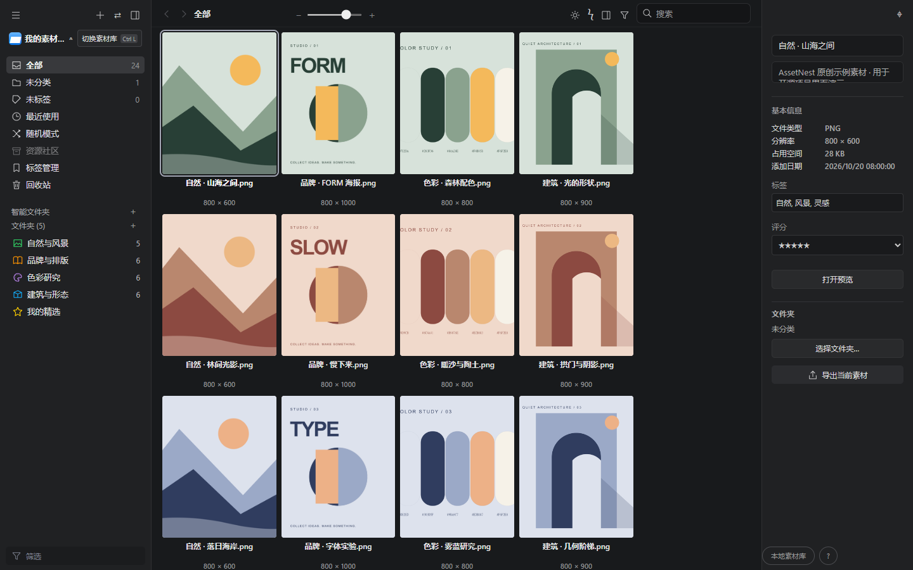
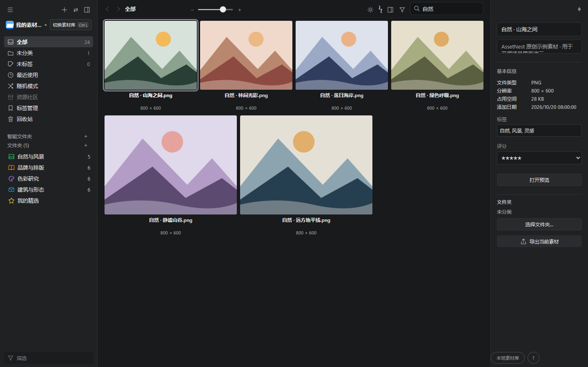
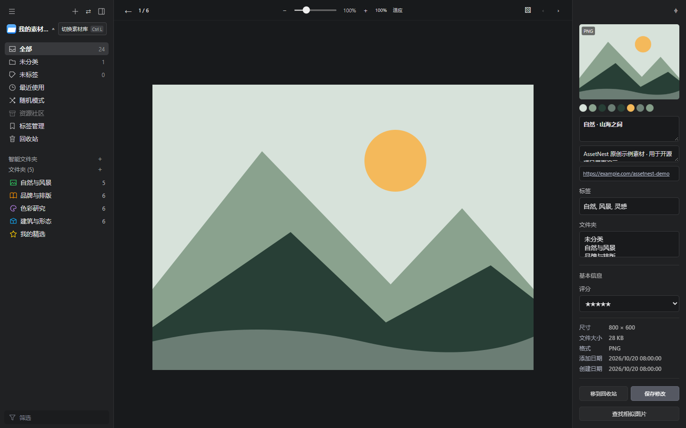

# 拾素材 · AssetNest

本地优先的素材管理工具，包含 Windows 桌面客户端与 Chrome / Edge 网页采集扩展。当前服务版本 0.10.3。无需云端账号，素材和索引保存在本机。

## 界面与操作演示

浏览素材 → 搜索 → 大图预览 → 多文件夹归类。以下演示录于 0.9.0，使用 24 张原创示例素材，本机路径已遮盖；0.10.3 已更新属性栏，详见[版本说明](docs/0.10.3.md)。



<details>
<summary>查看高清界面截图</summary>

素材浏览与信息面板：



按名称与标签搜索：



大图预览与元数据：



</details>

## 下载安装

Windows x64 用户可直接下载 [0.10.3 安装包](https://github.com/finnwang6-droid/AssetNest/releases/download/v0.10.3/AssetNest-Setup-0.10.3.exe)，无需安装 Node.js。

[完整软件与扩展包](https://github.com/finnwang6-droid/AssetNest/releases/download/v0.10.3/AssetNest-0.10.3-Windows-x64.zip)包含安装程序、可加载的浏览器扩展目录与安装说明。更多下载及 SHA-256 校验文件见 [Releases](https://github.com/finnwang6-droid/AssetNest/releases/latest)。桌面窗口需要 Microsoft Edge WebView2 Runtime；安装包尚未进行代码签名。

## 0.10.3 更新

- 拖拽文件后台准备，支持准备阶段取消，提前松开不再启动拖放。
- 区分接收、拒收和取消；缺失原件指出具体素材，过长路径提供处理建议。
- 改进多选、中文长文件名、同名文件和失败后的恢复。145 项公开版测试通过，QQ／微信接收获用户实测通过反馈。
- 保留原文件跨软件拖拽、属性栏、PDF 封面和监控文件夹。详见[版本说明](docs/0.10.3.md)。

## 功能

- 图片及多种文件格式的本地保存、预览、搜索、标签与文件夹整理。
- 网页图片采集、批量队列、区域截图与网页收藏。
- Eagle 素材包导入导出，以及 Eagle 素材库的直接读写；直接写入前请退出 Eagle 并备份原库。
- 后台缩略图任务、回收站、完整性检查、备份及索引重建。

## 从源码启动

需要 Node.js 24 或以上版本。Windows 上可使用 PowerShell；先安装项目依赖：

```sh
npm install
npm start
```

打开 http://127.0.0.1:41600 。默认使用项目内 data/ 目录。Windows 上也可双击 start.cmd，首次启动会提示选择素材库。源码仓库不附带 Node.exe 或安装包，start.ps1 会使用系统 PATH 中的 Node.js。

可用 ASSETNEST_DATA 指定启动数据目录、ASSETNEST_CONFIG 指定素材库配置文件、ASSETNEST_PORT 指定端口。Windows 原生桌面编译说明见 [开发说明](docs/DEVELOPMENT.md)。

## 浏览器扩展

1. 在 chrome://extensions 或 edge://extensions 启用开发者模式。
2. 加载已解压的扩展，选择 extension/ 目录。
3. 启动本地服务并完成素材库位置设置，再打开扩展。
4. 扩展自动连接本机服务；也可在扩展设置中手动填写本机地址与连接密钥。

扩展需要 HTTP/HTTPS 站点权限以扫描和采集用户选择的网页内容。登录态图片受浏览器和站点策略限制。完整的组件、请求流、密钥与临时令牌说明见 [认证与安全边界](docs/AUTHENTICATION.md)。

## 验证

```sh
npm test
```

测试使用临时目录和程序生成的素材，不需要个人素材库。Node.js 的 SQLite 功能可能显示实验性提示。

## 开源范围

此仓库包含应用源码、扩展、合成测试夹具与必要的开源预览资源。个人素材库、连接密钥、浏览器配置、日志、截图、历史分析证据、安装包和从商业软件提取的图标均未纳入。文件夹和菜单图标为本项目自绘 SVG。

本项目是独立实现，与 Eagle 无隶属或官方合作关系；不包含其授权校验、程序修改或商业资源。Eagle 名称仅用于说明格式兼容性。

## 许可证

项目原创代码与自绘资源采用 [MIT](LICENSE)。第三方资源保留原许可证，见 [第三方说明](THIRD_PARTY_NOTICES.md)。
