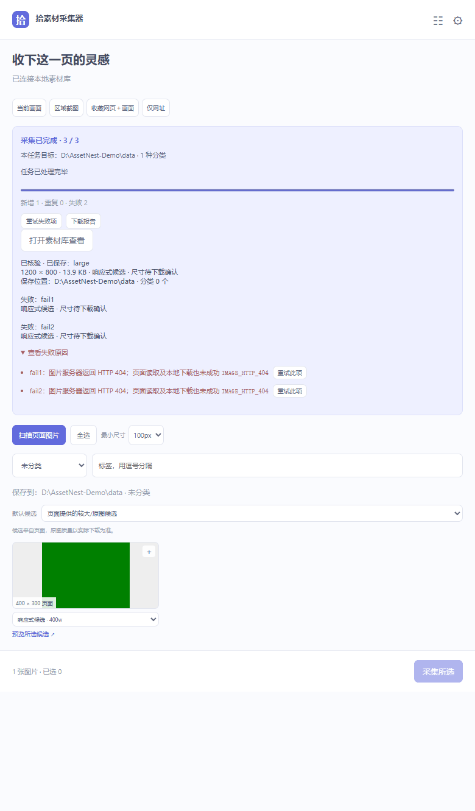

# AssetNest 0.11.0：采集候选、重复处理与任务结果

桌面服务 0.11.0，Chrome / Edge 采集扩展 0.6.0。

## 图片候选

- 候选来源使用中文说明，区分当前显示图、响应式候选、图片链接与页面标记原图。
- 页面实际尺寸与候选宽度提示分开显示，不再把响应式候选宽度与当前图片高度拼成一组尺寸。
- 每张图片可以切换候选并打开“预览所选候选”。带签名的 URL 保持原样，不猜测或改写原图地址。
- 页面标记的原图并不保证是最高质量；最终尺寸和大小以下载、入库后的结果为准。

## 重复图片

仍按 SHA-256 判断相同内容。选择“使用已有素材并归类”或“保留两者”时，可勾选“将此次选择应用到本任务剩余重复图片”。默认只处理当前一项；批量选择保存在该任务中，扩展后台恢复后继续生效，新任务重新询问。

## 任务结果与重试

- 区分本任务的目标库和当前新任务的保存设置；每项结果记录实际保存路径、分类数量、真实尺寸、文件大小及服务端校验状态。
- 可以重试全部失败项，也可以逐项重试。没有选择的失败项保留在面板中，之后仍可继续重试。
- 重试保留原目标素材库，并创建新的任务回执，保留前一任务关联。已成功的素材不会一起重下。
- 目标库已切换时，重试先暂停。只有明确点击“将全部未保存项改存到当前库并继续”后，全部未保存项（包括待重试失败项）才重新绑定到新库；无效旧分类会清除。
- 历史记录保留目标库，下载报告包含校验与失败详情，内嵌图片内容从报告中省略。

## 验证

150 项 Node 测试通过，覆盖目标库、重试回执、未选失败项保留、持久化重复策略与实际保存信息。另使用独立 Edge 配置、真实扩展后台和临时素材库完成候选选择、实际下载、单项重试、批量重复与切库暂停／确认继续的浏览器验证，页面运行错误为零。

复现：安装开发依赖后运行 `pnpm test`；设置 `PLAYWRIGHT_MODULE` 指向 Playwright 模块，再运行 `node tools/capture-browser-check.mjs`。该检查使用独立临时目录、合成测试图片和端口 41770；默认查找 Windows Edge，可用 `EDGE_PATH` 指定其他安装位置。

演示来自原创合成图片的真实测试界面，路径替换为示例路径；展示失败项、重复批量选择与完成结果三个状态。

## 升级

安装新版桌面程序后，将扩展更新为 0.6.0。手动加载扩展的用户需解压新扩展包，在浏览器扩展管理页加载新目录或替换原目录后点击重新加载。建议先处理完旧任务再更新扩展。

素材库格式不变，保留原文件跨软件拖拽、属性栏、PDF 首页封面及监控文件夹。Windows x64，需系统 Microsoft Edge WebView2 Runtime。
