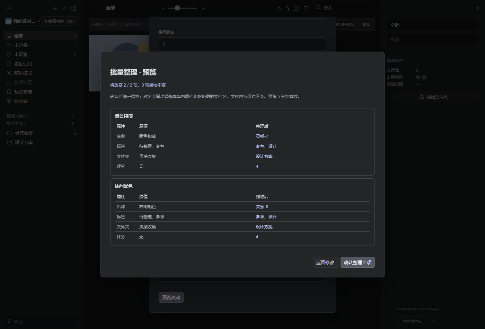

# AssetNest 0.12.0：批量整理预览与撤销

## 批量操作先看再改

多选素材后点击“批量编辑”，可以设置改名编号、添加或移除标签、文件夹归属、评分和统一注释。点击“预览改动”逐项查看原值与整理后值，再确认统一提交。返回修改会保留已填内容。未发生变化的素材不会重写。

改名会同步调整本库内原件和缩略图的文件名，原文件内容与附属文件保持不变。编号顺序按选择顺序；一次最多 500 项，预览有效期 5 分钟。

预览后如果素材、标签影响范围改变，或目标文件夹被删除，确认会停止并要求重新预览，不会把部分过期结果写进去。

## 撤销最近一次整理

通过顶部菜单“撤销最近批量整理”，可恢复最近一次经预览确认的批量操作，包括名称、标签、文件夹、评分和注释。记录按素材库保存，关闭程序再打开仍然有效。

撤销记录与素材更改在同一数据库事务中提交，并复用现有文件事务恢复机制。写入中断后，素材与撤销记录一起回滚或一起保留。

为避免覆盖后续工作，只要受影响素材后来被修改、原件缺失或损坏，整次撤销就会停止；如果原文件夹已删除，也不能恢复旧归属。每个库只保留最近一次成功整理，没有多步撤销或重做。单项属性编辑、旧版批量 API、采集和回收站操作不新增撤销记录；它们修改了同一素材时，也可能使旧记录无法安全撤销。永久删除相关素材会同时清除这条撤销记录。重建到新库不继承旧库撤销历史。

## 标签查找与合并

标签管理增加搜索与数量显示，可以查找完整标签列表，不受侧栏前 40 个标签的展示限制。重命名为已有标签会合并并去除重复；移除与合并均先预览影响范围，再确认执行，也支持撤销。

标签管理操作包含回收站素材，预览中会标明。超过 500 个受影响素材时，本版拒绝整库标签操作，请先通过筛选和批量整理分批处理。

## 验证

160 项 Node 测试通过，包含预览只读、过期与并发更改、标签范围变化、事务失败回滚、真实进程中断、重启后撤销、Eagle 库往返保真、删除清理及 API 密钥／来源／目标库边界。

独立 Edge 浏览器和临时素材库验证了多选整理、确认前并发修改拦截、返回修改、重启服务后撤销、52 个标签的完整搜索及合并去重；原创测试图片字节不变，页面运行错误为零。

运行 `pnpm test` 验证全部测试。设置 `PLAYWRIGHT_MODULE` 指向 Playwright 模块后运行 `node tools/organization-browser-check.mjs` 复现界面验证；检查使用独立临时目录和端口 41773，默认查找 Windows Edge，可设置 `EDGE_PATH` 指定安装位置。

GIF 展示原创合成素材的真实界面，库路径已替换为示例路径。

## 升级

Windows x64 桌面程序升级至 0.12.0。素材与原有配置保留；新增的撤销表由启动时创建。采集扩展仍为 0.6.0，已安装该版本的用户无需重新加载扩展。

继续保留 0.11.0 采集流程、原件跨软件拖拽、属性栏、PDF 封面和监控文件夹。需要系统 Microsoft Edge WebView2 Runtime。
