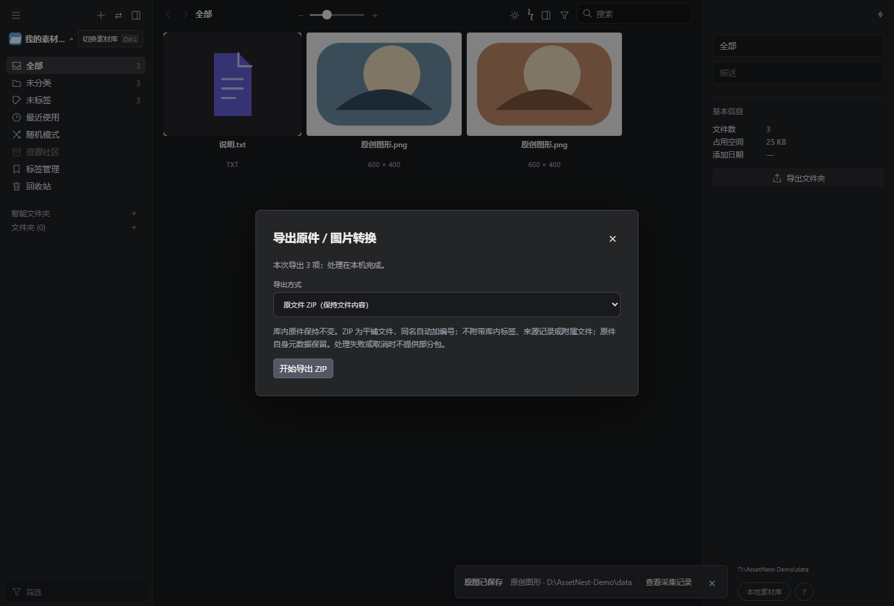

# AssetNest 0.13.0：原件 ZIP 导出与静态图片转换

## 使用入口

多选素材后，点击“导出原件 / 转换”；素材右键菜单也提供同一入口。顶部菜单可选择“导出当前筛选原件 / 转换”。一次选择 1～500 项。

原有 Eagle 素材包导出继续保留。文件 ZIP 适合解压后直接使用；需要交换标签、来源、文件夹与附属文件时，请使用原有素材包导出。

## 导出原文件

将选中的索引原件按文件名平铺放入 ZIP，并在打包时校验 SHA-256。相同名字、大小写冲突或 Unicode 规范化后冲突会加编号，保留每一个选中项；Windows 无效文件名会调整为可解压的名字。

库内原件、路径和元数据不变。ZIP 不额外附带库内标签、来源记录或附属文件，原文件自身的内容与元数据照常保留。单个文件需小于 4GB。

## 图片转换

- 支持静态 JPEG、PNG、WebP、AVIF、TIFF、GIF 输入，输出 JPG、PNG 或 WebP。
- 可设置最长边 0～10000 像素，0 表示保持原尺寸。自动校正图片方向，只缩小、不放大。
- JPG / WebP 质量可设为 1～100；PNG 使用无损压缩。
- PNG / WebP 保留透明区域；JPG 用所选背景色填充，默认为白色。
- 转为 sRGB，输出不保留 EXIF 等元数据。多帧或多页文件拒绝静态转换，避免无提示丢掉动图或后续页面；请改用导出原件。
- 单张输入最多 100MB、4000 万像素，处理超时为 15 秒；单张转换结果最多 50MB。

转换从经原件哈希校验的临时副本读取，输出写入任务缓存，不修改或重新入库源素材。

## 任务与下载

任务显示当前文件、处理数量、打包阶段及完成结果的实际尺寸和大小。可关闭导出窗口，稍后从“任务与维护”下载。完成包保留 10 分钟；程序重启或切换素材库后需要重新导出。

处理期间仍可浏览，修改、采集和切库需等待或取消任务。取消转换会等待当前图片处理结束。任一文件失败或用户取消，都不提供部分 ZIP；临时输出会清理，原库保留。

## 验证

168 项 Node 测试通过，覆盖原件字节、同名处理、透明度、方向校正、缩小且不放大、EXIF 移除、动图拒绝、损坏与变更原件、取消、空间不足、过期清理及 API 密钥／来源／目标库检查。

独立 Edge 和临时素材库验证了多选导出、原件实际下载哈希、120 像素 JPG 转换、同名保留、混合不支持格式拒绝及任务面板继续下载，页面运行错误为零，源图片哈希不变。

运行 `pnpm test` 执行测试；设置 `PLAYWRIGHT_MODULE` 后运行 `node tools/file-export-browser-check.mjs` 复现界面检查。检查使用端口 41775、独立临时目录及原创合成图片；默认查找 Windows Edge，可设置 `EDGE_PATH` 指定浏览器路径。

GIF 来自真实界面，使用原创合成图片，库路径已替换为示例路径。

## 升级

Windows x64 桌面程序升级至 0.13.0，保留素材和启动配置。扩展仍为 0.6.0，已安装的用户无需更新扩展。继续保留批量整理预览与撤销、网页采集、原件跨软件拖拽、属性栏、PDF 封面及监控文件夹。需要系统 Microsoft Edge WebView2 Runtime。
